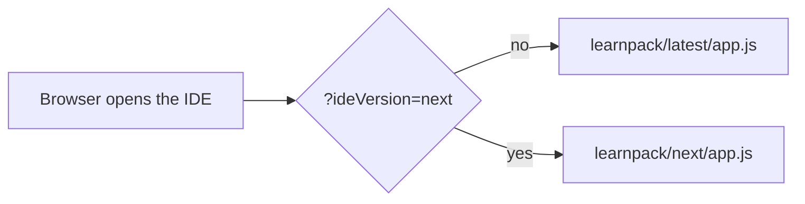
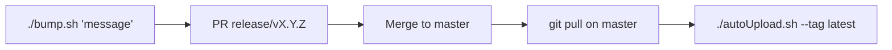
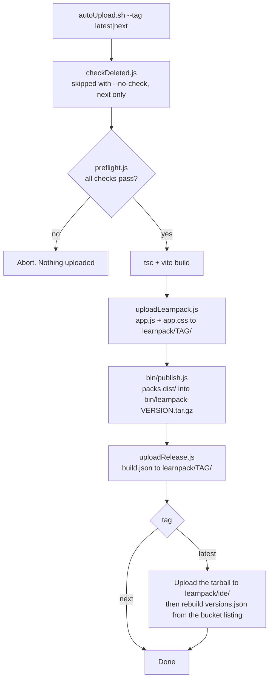
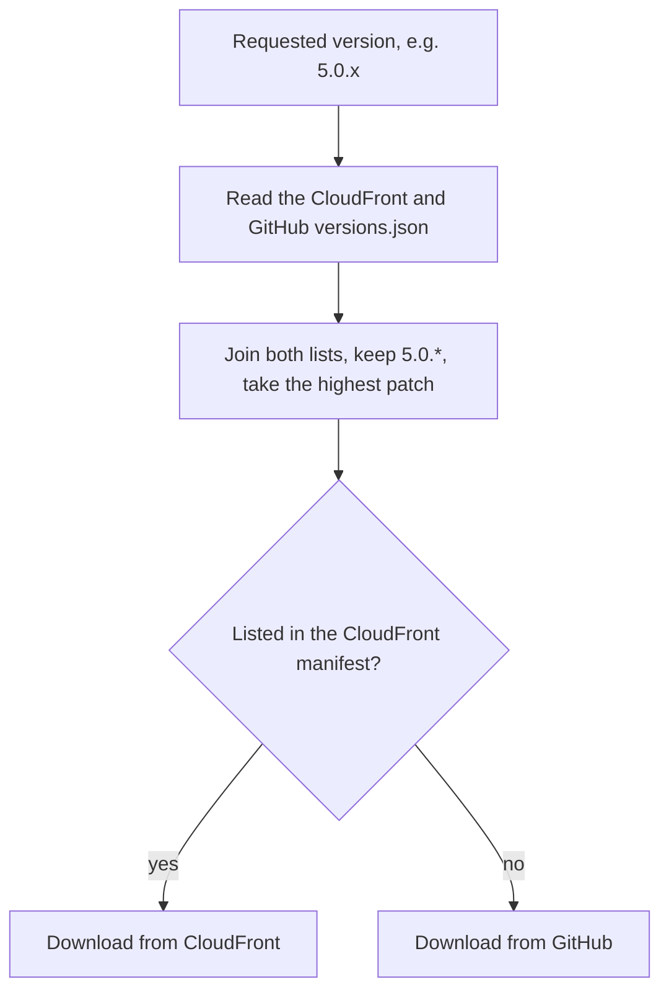

# Releasing the IDE

The IDE is published to CloudFront (S3 bucket `learnpack-packages`, domain
`https://d3a7w3e3g8ydll.cloudfront.net`). Releases are run by hand with
`./autoUpload.sh`. The script never commits or pushes: `master` is protected, so the
version bump goes through a PR first, opened with `./bump.sh`.

## What gets published

| File | Path on CloudFront | What it is |
| --- | --- | --- |
| `app.js`, `app.css` | `learnpack/<tag>/` (`latest` also writes `learnpack/v5/`) | The IDE code. Browsers load it from here. |
| `learnpack-<version>.tar.gz` | `learnpack/ide/` | The tarball the CLI downloads into `.learn/_app`. Its `index.html` loads `app.js`/`app.css` from CloudFront, so it is a thin shell. Never overwritten. |
| `versions.json` | `learnpack/ide/versions.json` | List of published tarballs. The CLI reads it to pick a version. |
| `build.json` | `learnpack/<tag>/build.json` | What is live on each channel: version, branch, commit, date. |

Tarballs up to 5.0.416 live in this repo (`bin/`, `versions.json`), which is frozen. The
CLI merges both lists.

## Channels (`--tag`)

| | `latest` | `next` |
| --- | --- | --- |
| Who gets it | Everyone | Only whoever opens the IDE with `?ideVersion=next` |
| Branch | `master` | Any pushed branch |
| Version bump needed | Yes, through a PR (`./bump.sh`) | No |
| Uploads | `app.js`/`app.css`, tarball, `versions.json`, `build.json` | `app.js`/`app.css`, `build.json` |

Use `next` to try a change for real before releasing it to everyone.

## How to release

**latest**

1. `./bump.sh "What this release contains"` opens the PR that bumps the version
   (e.g. `5.0.417` → `5.0.418`).
2. Get the PR reviewed and merge it.
3. `git checkout master && git pull`
4. `./autoUpload.sh --tag latest`

Nothing has to be committed after the release: the tarball and `versions.json` live on
CloudFront, not in git.

**next**

1. Push your branch.
2. `./autoUpload.sh --tag next`
3. Open the IDE with `?ideVersion=next`.

No PR and no version bump.

### `bump.sh` options

| Option | Effect |
| --- | --- |
| `"Message"` | Required. Goes into the commit and the PR description. |
| `--minor`, `--major` | Bump that part instead of the patch (`5.0.417` → `5.1.0` or `6.0.0`). |
| `--dry-run` | Creates the commit locally, shows it and undoes it. Nothing is pushed. |
| `-h`, `--help` | Shows the usage. |

What it does: takes the version from `origin/master`, creates `release/v<version>` from
it, changes only the `version` line of `package.json`, commits
(`chore(release): set version to X.Y.Z`), pushes, opens the PR with the GitHub CLI and
goes back to your branch. It needs [`gh`](https://cli.github.com) logged in
(`gh auth login`) and no uncommitted changes. It doesn't publish anything.

### `autoUpload.sh` options

| Option | Effect |
| --- | --- |
| `--tag latest\|next` | Required. Channel to publish. |
| `--no-check` | Only with `--tag next`. Skips `checkDeleted.js`, which deletes local test content (`public/.learn`, `public/exercises`, `public/config.json`) before building. Use it to keep a sample package you are testing with: `next` doesn't publish a tarball, so that content goes nowhere. `latest` rejects it, because Vite copies `public/` into `dist/` and the content would end up in the published tarball. |
| `-h`, `--help` | Shows the usage. |

### Requirements

An `.env` with `AWS_ACCESS_KEY_ID`, `AWS_SECRET_ACCESS_KEY`, `AWS_REGION`, `BUCKET_NAME`
and `CLOUDFRONT_DOMAIN`. The key needs `s3:PutObject`, `s3:GetObject` and `s3:ListBucket`
on the bucket.

## What the script does

`autoUpload.sh` runs `npm run build`, which chains these steps. If one fails, the
following ones don't run.

### Preflight checks

| Check | Applies to |
| --- | --- |
| `--tag` is `latest` or `next`; `package.json` has a valid version; `.env` is complete | both |
| No uncommitted changes, and the branch matches `origin/<branch>` | both |
| Current branch is `master` | `latest` |
| That version's tarball is not on CloudFront yet | `latest` |

## How the CLI picks a tarball

The CLI (`learnpack-cli/src/managers/ideReleases.ts`) downloads the tarball when
`.learn/_app` is missing. It only uses the major.minor of the requested version and
takes the highest patch.

If CloudFront can't be reached, the CLI uses the GitHub list alone. CLIs released before
this change only read GitHub (stuck at 5.0.416), but they still get the current `app.js`,
because the tarball loads it from CloudFront.

## Troubleshooting

| Message | What to do |
| --- | --- |
| `version X is already published` | Bump the version with `./bump.sh` and merge the PR. Published tarballs are never replaced. |
| `bump.sh`: `branch release/vX.Y.Z already exists on origin` | A release PR is already open. Merge it, or close it and delete the branch. |
| `latest releases must run from master` | Switch to `master`, or use `--tag next`. |
| `not in sync with origin` | `git pull` or `git push`. |
| `403 ... ListBucket` | The AWS key lacks `s3:ListBucket`. |
| `uploadRelease.js` failed (e.g. network) after the tarball was packed | Fix the cause and run `RELEASE_TAG=latest node src/utils/uploadRelease.js`. It uploads the existing `bin/` tarball and rebuilds the manifest. |

To check that the code compiles, use `npx tsc && npx vite build`. Don't run
`npm run build` by itself: it is the release.
